# zmk-config-velvet




_(keymap image generated by [caksoylar/keymap-drawer](https://github.com/caksoylar/keymap-drawer))_

## TPS43 trackpad (dongle + right half)

The trackpad is an Azoteq TPS43 (IQS5xx) on the **right peripheral**. The
dongle is the Studio central and has no `azoteq,iqs5xx` node; DYA Studio reaches
the trackpad through the split relay.

```
Studio (USB) → dongle RPC (source 1)
             → RelayRequest split event
             → right half relay executor → iqs5xx over I2C
             → RelayResponse split event
             → dongle PeripheralResponse notification → Studio
```

### Kconfig

Both halves must opt in to the relay. A `RelayResponse` encodes to 142 bytes,
so `CONFIG_ZMK_SPLIT_RELAY_EVENT_DATA_LEN` must be at least 240; ZMK's 128-byte
default fails the module's build-time assert.

Dongle (`boards/shields/velvet/velvet_central_dongle.conf`):

```conf
CONFIG_ZMK_STUDIO=y
CONFIG_ZMK_TPS43_STUDIO_RPC=y
CONFIG_ZMK_TPS43_SPLIT_RPC_RELAY=y
CONFIG_ZMK_SPLIT_RELAY_EVENT=y
CONFIG_ZMK_SPLIT_RELAY_EVENT_DATA_LEN=240
CONFIG_ZMK_RUNTIME_INPUT_PROCESSOR=y
CONFIG_ZMK_RUNTIME_INPUT_PROCESSOR_STUDIO_RPC=y
CONFIG_ZMK_LOW_PRIORITY_THREAD_STACK_SIZE=4096
```

Right half (`boards/shields/velvet/velvet_peripheral_right.conf`):

```conf
CONFIG_ZMK_TPS43=y
CONFIG_ZMK_TPS43_SPLIT_RPC_RELAY=y
CONFIG_ZMK_TPS43_CUSTOM_SETTINGS=y
CONFIG_ZMK_CUSTOM_SETTINGS=y
CONFIG_ZMK_CUSTOM_SETTINGS_SPLIT_RPC_RELAY=y
CONFIG_ZMK_SPLIT_RELAY_EVENT=y
CONFIG_ZMK_SPLIT_RELAY_EVENT_DATA_LEN=240
```

The left half deliberately has none of these symbols: a half without a
trackpad must not answer relayed requests.

### Devicetree

Right half (`boards/shields/velvet/tps43.dtsi` + `velvet_peripheral_right.overlay`):
the driver node and the split-input proxy pointed at it.

```dts
&i2c0 {
    tps43: iqs5xx@74 {
        compatible = "azoteq,iqs5xx";
        reg = <0x74>;
        reset-gpios = <&gpio1 0 GPIO_ACTIVE_LOW>;
        rdy-gpios = <&gpio0 11 GPIO_ACTIVE_HIGH>;
        one-finger-tap;
        two-finger-tap;
        scroll;
    };
};

&tps43_split {
    device = <&tps43>;
};
```

Dongle (`boards/shields/velvet/velvet_central_dongle.overlay`): a listener on
the split-input proxy. The runtime processor is central-side state, so pointer
speed lives here.

```dts
/ {
    split_inputs {
        #address-cells = <1>;
        #size-cells = <0>;

        tps43_split: tps43_split@0 {
            compatible = "zmk,input-split";
            reg = <0>;
        };
    };

    tps43_listener {
        compatible = "zmk,input-listener";
        device = <&tps43_split>;
        input-processors = <&mouse_runtime_input_processor>;
    };
};
```

### Checking a build

```bash
west build -b eyelash_nano --shield velvet_central_dongle -d build/velvet_central_dongle -p
west build -b eyelash_nano --shield velvet_peripheral_left -d build/velvet_peripheral_left -p
west build -b eyelash_nano --shield velvet_peripheral_right -d build/velvet_peripheral_right -p
scripts/check_tps43_config.sh
```

`scripts/check_tps43_config.sh` needs all three builds and asserts the dongle's
generated `.config` has the RPC, relay, and 240-byte relay buffer, the right half
has the driver/relay/custom-settings symbols, and the left half has no TPS43
symbols. Record the dongle's RAM/flash figures before merging: the dongle has no
trackpad driver but does carry the RPC, relay, and notification buffers.

Hardware: confirm the dongle page discovers the right-half trackpad, get/set/
reset persist across a reboot, scroll has no cursor jumps, and the `Pointer
speed` slider moves the cursor speed (via the dongle's runtime input processor).
See the `tps43-input-module` README for the v1 limitations.
